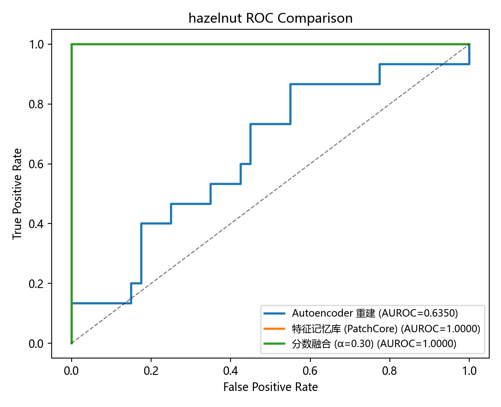
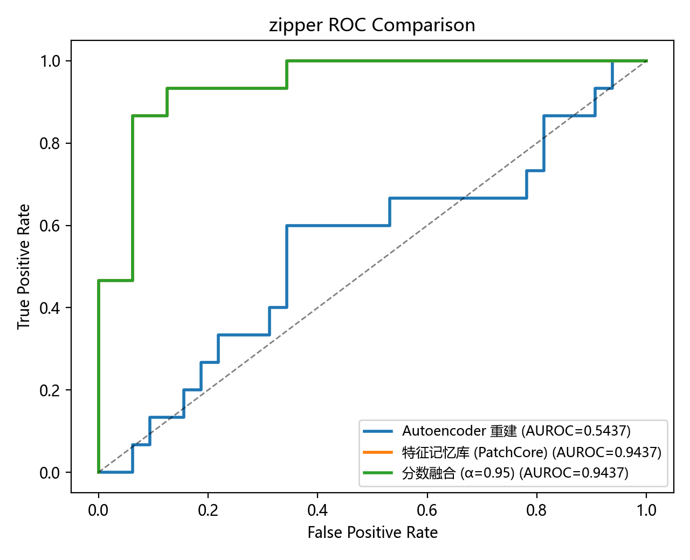
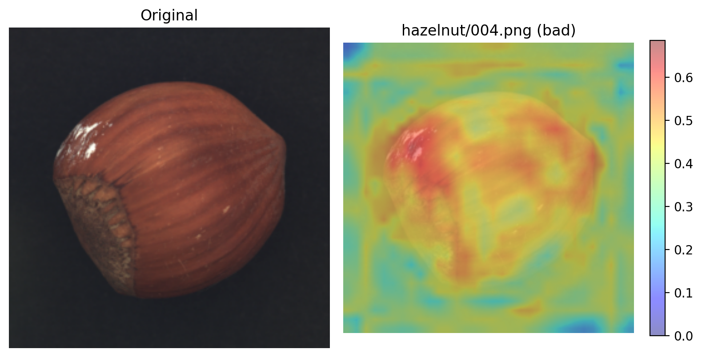
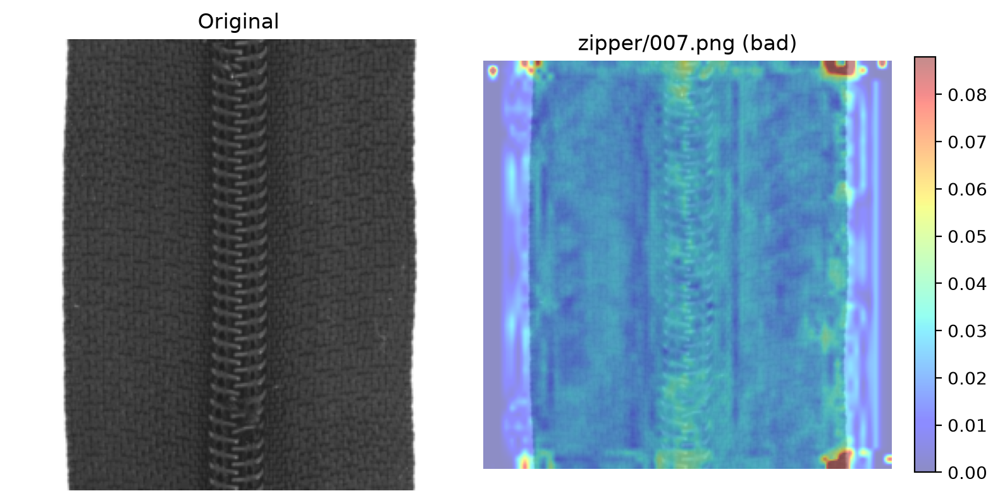

# 任务2：图像异常检测实验报告

## 1. 问题定义与数据

本任务使用课程 Image_Anomaly_Detection 数据集，对 hazelnut（榛子）和 zipper（拉链）分别建立异常检测器。给定图像 $x$，模型输出异常分数 $s(x)$，分数越大表示越偏离正常图像；以固定阈值 $\tau$ 输出二分类结果 $\hat y=\mathbb{1}[s(x)\geq\tau]$，其中0为正常、1为异常。

| 类别 | 训练正常 | 训练异常 | 正常拟合集 | 正常校准集 | 测试正常 | 测试异常 |
| --- | ---: | ---: | ---: | ---: | ---: | ---: |
| hazelnut | 200 | 50 | 180 | 20 | 40 | 15 |
| zipper | 200 | 50 | 180 | 20 | 32 | 15 |

两类分别建模，不混合课程给定的训练集和测试集。每类200张训练正常图像按文件名排序，以NumPy随机种子42固定划分为90%拟合集和10%校准集。50张训练异常图像保留但不使用。主方案的特征编码器采用ImageNet有监督预训练权重，在本任务中冻结；课程图像不用于微调编码器，只用正常拟合集构建记忆库。

测试标签来自 `image_anomaly_labels.json`。AE基线和主方案均不使用测试标签拟合模型、选择阈值或拟合分数缩放。后文探索性融合会用测试标签选择融合权重，因此单独标注其使用边界。

## 2. 图像特征处理

### 2.1 预处理

图像统一转换为RGB，直接双线性缩放到256×256，不做中心裁剪。预训练ResNet-18输入按ImageNet均值[0.485, 0.456, 0.406]、标准差[0.229, 0.224, 0.225]归一化。AE基线只将像素缩放到[0,1]，与解码器Sigmoid输出对应。

### 2.2 主方案的多尺度局部特征

使用ResNet-18的 `IMAGENET1K_V1` 权重并冻结参数。提取 `layer2` 的32×32×128特征和 `layer3` 的16×16×256特征，分别进行核为3×3、步长1、填充1的局部平均池化。将第三层特征双线性上采样到32×32，再沿通道拼接。

每张图像得到1024个384维patch向量，各向量做L2归一化。该表征同时保留局部纹理和较大感受野的信息；与整图像素平均重建误差相比，局部特征有利于避免少量缺陷被正常区域稀释。该解释是方法设计依据，具体效果由第4节实验验证。

## 3. 异常检测算法与实验设置

### 3.1 正常记忆库与图像分数

每个类别的180张拟合图像产生184320个patch向量。固定种子42，从中随机无放回抽取10000个候选，再进行贪心远点采样：从候选池首点开始，每轮加入距离已选集合最远的点，保留候选数的10%，得到1000个384维正常特征组成的记忆库 $M$。

测试图像中每个patch的异常分数是其到正常记忆库的最近邻欧氏距离：

$$d_j(x)=\min_{m\in M}\|z_j(x)-m\|_2.$$
将1024个距离从大到小排序，以最大的3个距离均值作为图像级分数：
$$s(x)=\frac{1}{3}\sum_{j\in\operatorname{Top3}(d(x))}d_j(x).$$

最近邻距离计算使用分块矩阵运算。热力图将32×32的patch距离图插值回图像大小，作为模型关注区域的可视化。

### 3.2 独立正常校准阈值

每类20张正常校准图像不参与记忆库构建。计算其图像分数，用 `numpy.quantile` 默认线性插值取99%分位数作为该类别阈值。AE基线也使用同一划分独立校准，阈值不共用。主方案的实际阈值为：

| 类别 | 正常校准样本数 | 阈值 |
| --- | ---: | ---: |
| hazelnut | 20 | 0.6166773635 |
| zipper | 20 | 0.4156771860 |

99%是校准分数的分位数参数，不保证新样本误报率恰好为1%。20张校准图像较少，分布尾部的估计可能受单个样本影响。

### 3.3 AE重建基线与融合分析

AE编码器使用5个步长2的4×4卷积层，通道依次为32、64、128、256、64，将256×256图像压缩为8×8×64；解码器使用对称的转置卷积和Sigmoid输出。采用Adam优化像素均方误差，学习率0.001，余弦退火调度，批大小16，种子42。本次对照训练10轮，图像分数为RGB通道及全部像素的平均重建平方误差。CLI默认轮数为60，复现本报告应显式指定10轮。

补充融合在各方法的正常校准分数上拟合min-max缩放，再计算 $s_\alpha=\alpha\tilde s_{\mathrm{memory}}+(1-\alpha)\tilde s_{\mathrm{AE}}$。以0.05为步长扫描0到1，使用测试AUROC选择权重；各候选阈值仍由融合后的正常校准分数确定。本次hazelnut和zipper选得权重分别为0.30和0.95。由于权重使用了测试标签，融合结果只作探索性参考，不用于主方法泛化结论。

## 4. 评价指标与结果

AUROC评价异常分数对正常/异常图像的排序能力，AP为平均精确率。F1、精确率、召回率和准确率均由固定校准阈值计算。两类单独报告结果，以下数值按指标表保留4位小数，精确值见各方法的 `metrics.json`。

| 类别 | 方法 | AUROC | AP | F1 | 精确率 | 召回率 | 准确率 |
| --- | --- | ---: | ---: | ---: | ---: | ---: | ---: |
| hazelnut | AE重建，10轮 | 0.6350 | 0.4494 | 0.0000 | 0.0000 | 0.0000 | 0.7273 |
| hazelnut | ResNet-18＋记忆库 | 1.0000 | 1.0000 | 0.9677 | 0.9375 | 1.0000 | 0.9818 |
| hazelnut | 探索性融合 | 1.0000 | 1.0000 | 0.9286 | 1.0000 | 0.8667 | 0.9636 |
| zipper | AE重建，10轮 | 0.5437 | 0.3696 | 0.1053 | 0.2500 | 0.0667 | 0.6383 |
| zipper | ResNet-18＋记忆库 | 0.9437 | 0.8917 | 0.8667 | 0.8667 | 0.8667 | 0.9149 |
| zipper | 探索性融合 | 0.9437 | 0.8917 | 0.8276 | 0.8571 | 0.8000 | 0.8936 |

主方案zipper的精确AUROC为0.94375。hazelnut虽然AUROC为1.0，固定正常校准阈值下仍有1张正常图像误报；排序指标和给定阈值下的分类指标应分别解释。





图中的融合曲线包含测试集选权重的因素。主方案在本次两类测试图像上的AUROC和AP均高于10轮AE基线；融合未提升主方案的AUROC，固定阈值F1还略低。

## 5. 对照实验与误判分析

### 5.1 重建基线与局部记忆库

10轮AE在hazelnut上没有检出异常，在zipper上仅检出1张异常；平均重建误差及当前训练设置未形成有效的异常判定规则。不能把本次对照解释为AE充分训练后的性能上限。主方案利用冻结的预训练局部特征和正常样本之间的距离，在不训练课程异常标签的前提下得到更好的效果。

主方案在固定阈值下的分类计数如下。TP为正确检出的异常，FN为漏检异常，FP为误报正常，TN为正确判断的正常：

| 类别 | TP | FN | FP | TN |
| --- | ---: | ---: | ---: | ---: |
| hazelnut | 15 | 0 | 1 | 39 |
| zipper | 13 | 2 | 2 | 30 |

### 5.2 具体误判与热力图

逐图像结果按测试目录排序，与本地 `scores.npz` 对齐。hazelnut的正常图像 `038.png` 分数为0.6170063，仅略高于0.6166774的阈值，说明边界样本对当前校准阈值较敏感。

zipper漏检的异常图像为 `007.png`、`021.png`，分数分别为0.3556269和0.3899067，低于0.4156772；误报的正常图像为 `023.png`、`036.png`，分数分别为0.4925642和0.5198497。对这两张漏检图像，本方法的Top-3局部距离尚不足以越过固定阈值。





热力图反映模型的局部距离分布，并不等同于像素级异常真值；本实验未使用像素掩码，也未评估分割或定位指标。降低阈值可能提高召回率，同时增加误报；若继续改进，应在独立开发/验证数据上制定选择规则，保留新的独立测试评估。

## 6. 运行与复现

本次环境为Windows、Python 3.11.15、PyTorch 2.7.1+cpu、torchvision 0.22.1+cpu、scikit-learn 1.7.2、NumPy 2.3.5，采用CPU。完整流程约7分钟，其中两个类别的AE训练分别为191.1秒、158.9秒；主方案两类的特征提取与记忆库构建分别约12.4秒、5.4秒，不需要AE训练。

安装依赖和放置数据见[项目 README 的任务2说明](../README.md#task2)。从仓库根目录执行，另存复现输出：

```powershell
.\.venv\Scripts\python.exe task2_image_anomaly/main.py --data-dir data/image_anomaly --output-dir results/task2/reproduced --experiment all --epochs 10 --device cpu --seed 42 --save-heatmaps
.\.venv\Scripts\python.exe -m pytest task2_image_anomaly/tests -q
```

数据根目录既支持直接包含hazelnut、zipper的结构，也支持保留 `Image_Anomaly_Detection/` 外层目录。主方案首次自动下载约45MB官方权重至输出目录；离线时可用 `--weights-path` 指定同一官方文件。本次权重SHA-256为 `f37072fd47e89c5e827621c5baffa7500819f7896bbacec160b1a16c560e07ec`，具体本地文件位置记录于[run.json](../results/task2/run.json)。

AE权重复用会核对拟合样本内容摘要、预处理和训练配置。旧格式或不匹配的自动缓存会重训，防止新校准集包含编码器曾拟合的图像。固定随机种子同时用于模型初始化、样本打乱、划分和记忆库采样。

已完成8项回归测试、真实数据完整流程，以及主方法的独立复跑；两次主方法的测试分数和正常校准分数逐项完全一致。记录见[verification.json](../results/task2/verification.json)。实验生成时使用合并提交 `225dba2` 后的本地修复，相关代码与本报告一起保存；`run.json` 的未提交标记记录实验生成时的状态，基础提交号不能单独复原本次源码。尚未进行干净克隆全流程复现，也未进行多种子统计。

版本管理保留指标、图表和说明；原始数据、权重、逐样本分数、校准分数及日志留在本地。复现后可用[指标表](../results/task2/compare/metrics_table.csv)、[主方案汇总](../results/task2/patchcore/summary.json)和[AE汇总](../results/task2/autoencoder/summary.json)核对结果。

## 7. 结论

本实验完成hazelnut和zipper的图像级异常检测。冻结ResNet-18多尺度局部特征与正常记忆库的主方案，在给定测试集上的AUROC分别为1.0000和0.94375，固定正常校准阈值下检出15/15、13/15张异常图像。10轮AE重建基线效果较弱，探索性融合未超过主方案。当前结果支持该局部特征方案在这批数据上的有效性；小规模校准集、单次划分和残留误判仍限制了结论范围。
