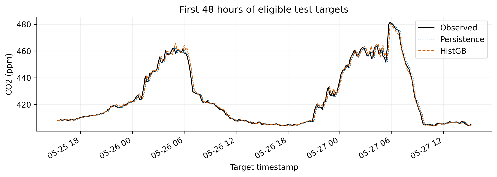
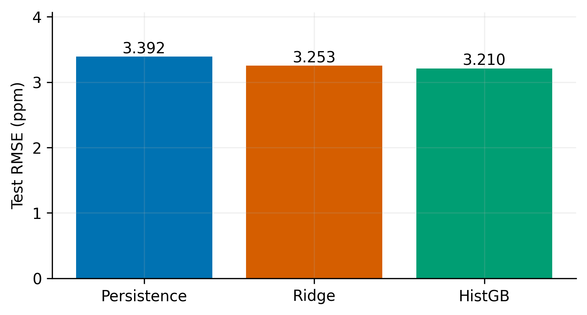

# 任务3：时间序列预测

## 问题描述与定义

给定按十分钟采样的气象序列，令 $\mathbf{x}_t\in\mathbb{R}^{21}$ 表示第 $t$ 个时间点的全部指标，
构造 $\mathbf{X}_t=[\mathbf{x}_{t-12},\ldots,\mathbf{x}_{t-1}]\in\mathbb{R}^{12\times21}$，
以 $y_t=\mathrm{CO2}_t$ 为标签。将窗口展平为252维向量，预测下一时刻的二氧化碳浓度，单位ppm。
此处预测浓度值；内部使用差分残差训练不改变最终预测目标。

## 数据预处理与划分

原始文件含26200行、日期列和21个指标，时间范围为2020年1月1日00:10至7月1日00:00。
原始数据的数值缺失并非空单元格：CO2、风速和最大PAR中分别存在34、1、10个$-9999$。
将这些标记和非有限数转为缺失；输入仅作前向填补，开头缺失使用训练期中位数。
真实目标缺失时不填补、不计入训练或评价。对1个重复时间戳保留第一条，得到26199行。
另有1处采样间断，要求输入窗口及其目标之间每步恰为10分钟，跨越间断的窗口全部剔除。

按时间顺序将原始行划分为60%、20%、20%三个分区，边界分别为15719、20959、26199。
每个分区独立构造窗口，前12行只作为历史，避免不同分区的输入窗口重叠。
验证与测试阶段使用滚动单步预测，即已观测的历史气象量可用于下一步预测，不是一次预测整段未来。
标准化器仅在当前模型的拟合数据上学习，测试期不参与拟合、模型选择或早停。

各时间分区的合格窗口数：

| Split | Windows |
| --- | ---: |
| train | 15673 |
| validation | 5228 |
| test | 5216 |

各分区的首末合格目标时间如下：

| 分区 | 首个目标时间 | 最后目标时间 |
| --- | --- | --- |
| train | 2020-01-01 02:10:00 | 2020-04-19 03:50:00 |
| validation | 2020-04-19 06:00:00 | 2020-05-25 13:10:00 |
| test | 2020-05-25 15:20:00 | 2020-07-01 00:00:00 |

## 方法与实验设置

Persistence直接以上一时刻CO2浓度作预测，是短期序列的必要基线。
Ridge对252维输入标准化后做岭回归，优化残差的平方损失和L2正则项。
HistGB使用直方图梯度提升回归树拟合非线性残差。两个学习模型统一采用

$$
\widehat y_t=y_{t-1}+g(\operatorname{vec}(\mathbf X_t)),
$$

并以 $y_t-y_{t-1}$ 为内部训练目标，输入均包含全部21个指标。
Ridge的正则系数搜索集合为$\{0.1,1,10,100,1000\}$；HistGB最大叶节点数为$\{7,15\}$，
固定迭代200轮、学习率0.05、L2系数10、每叶最少40个样本，关闭自动早停。
随机种子为2026，模型选择仅使用验证集RMSE。选择完毕后，在训练与验证的合格窗口上重新拟合，
在保留测试集上作统一评价。最终选择HistGB，最大叶节点数15，验证RMSE为2.2079 ppm。

## 实验结果分析

采用MAE、RMSE和$R^2$，前两者越小越好，后者越大越好。

$$
\mathrm{RMSE}=\sqrt{\frac{1}{N}\sum_{i=1}^{N}(y_i-\widehat y_i)^2}.
$$

测试集浓度预测误差（MAE、RMSE单位ppm）：

| Model | MAE | RMSE | R2 |
| --- | ---: | ---: | ---: |
| Persistence | 1.8723 | 3.3916 | 0.9775 |
| Ridge | 1.8189 | 3.2535 | 0.9793 |
| HistGB | 1.7590 | 3.2104 | 0.9799 |

验证集选定的HistGB测试MAE为1.7590 ppm，RMSE为3.2104 ppm，$R^2$为0.9799。相比Persistence，RMSE降低5.34%。
岭回归与树模型均优于基线，说明在本次划分中历史多变量特征提供了额外预测信息。
这不代表已证明某个气象指标对CO2的因果作用。测试RMSE高于验证RMSE，提示后段预测更困难，
可能与季节分布或波动幅度变化有关，尚未单独验证原因。
图中展示前288个合格测试目标，完整评价使用全部5216个目标，不能用局部曲线替代整体指标。

单一半年的时间划分不足以证明跨年份泛化；未来可以通过多个时间切分检验稳健性。

## 运行与结果记录

运行环境、命令和数据目录见[项目 README 的任务3说明](../README.md#task3)，文件索引见[结果说明](../results/README.md#task3)。精确指标见[metrics.csv](../results/task3/metrics.csv)，数据检查见[data_quality.json](../results/task3/data_quality.json)，数据摘要及依赖版本见[environment.json](../results/task3/environment.json)。

模型选择使用的候选参数、验证指标和耗时见[validation_search.csv](../results/task3/validation_search.csv)及[selection.json](../results/task3/selection.json)。
