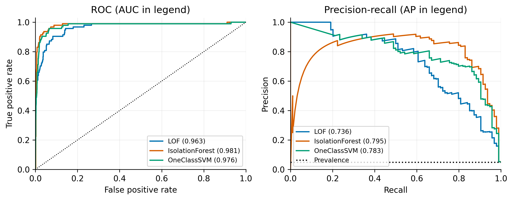
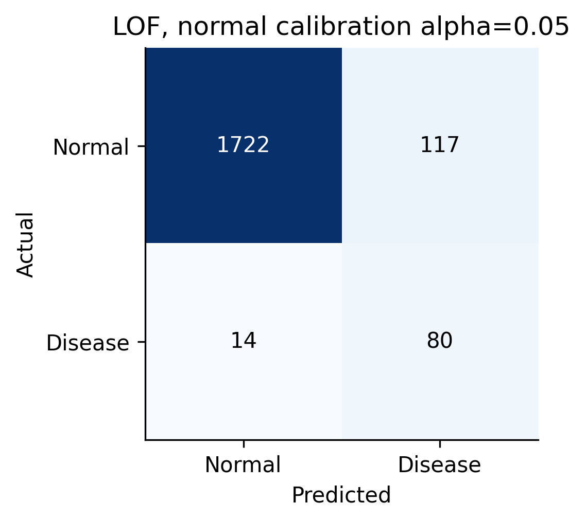

# 任务4：无监督疾病判断

## 问题描述与定义

训练集中均为正常样本，测试集同时包含正常和患病样本。
目标是从正常训练样本学习正常模式，对新样本输出异常分数$s(\mathbf x)$，分数越大越异常，
当$s(\mathbf x)>\tau$时判为患病（1），否则为正常（0）。这属于正常样本驱动的新颖性检测。

## 数据特点与处理

训练集1839行，测试集1933行，合计3772行；每行6个脱敏数值特征，无法确定原始医学含义。
测试集1839个正常样本、94个患病样本，患病率约4.86%，因此仅报告准确率会掩盖异常识别效果。
无缺失或非有限数。训练集有57个重复行，测试集有23个重复行，测试中56行的特征向量也出现于训练。
官方测试集全部保留；特征相同不能确定患者相同，缺少患者标识也无法证明患者级独立性。
对训练数据按相同特征向量分组，以随机种子2026划分拟合子集与正常校准子集，
分别为1476行和363行，两部分没有重复特征组重叠。标准化器仅在拟合子集上学习。

## 方法与阈值设计

预先指定LOF为主方法，使用35个邻居、novelty=True，以局部密度变化识别正常模式之外的样本。
LOF的新颖性接口仅对未参与拟合的校准集和测试集打分。
固定比较Isolation Forest（300棵树）和RBF One-Class SVM（$\nu=0.05$、gamma=scale），
不根据测试标签选择方法、调参或设置异常比例。所有异常分数均为模型 `score_samples` 取负。

仅使用正常校准分数确定阈值。令校准样本数为$m$，预设$\alpha=0.05$，排序分数为$s_{(1)}\le\cdots\le s_{(m)}$，取

$$
k=\left\lceil(m+1)(1-\alpha)\right\rceil,\qquad\tau=s_{(k)}.
$$

若$k>m$则阈值为正无穷。本实验$m=363$，使用第346个顺序统计量。
阈值确定后不再用校准集重训，防止分数尺度改变。该阈值控制设计依赖正常校准与未来正常样本可交换的假设；
分布偏移与重复依赖均可能使测试误报率偏离5%，不能声称无条件保证。

## 实验结果分析

报告ROC-AUC、平均精确率AP、精确率、召回率、F1和混淆矩阵。
AP使用 `average_precision_score`，不等同于梯形积分的PR-AUC。

固定模型的测试结果：

| Model | AUC | AP | F1 |
| --- | ---: | ---: | ---: |
| LOF | 0.9628 | 0.7361 | 0.5498 |
| IsolationForest | 0.9810 | 0.7950 | 0.6592 |
| OneClassSVM | 0.9765 | 0.7830 | 0.6296 |

正常校准阈值下的检测效果：

| Model | Precision | Recall | FPR |
| --- | ---: | ---: | ---: |
| LOF | 0.4061 | 0.8511 | 0.0636 |
| IsolationForest | 0.5087 | 0.9362 | 0.0462 |
| OneClassSVM | 0.4830 | 0.9043 | 0.0495 |

LOF的ROC-AUC为0.9628、AP为0.7361，检出94个患病样本中的80个，漏报14个；1839个正常样本中误报117个。召回率85.11%，精确率40.61%，误报率6.36%。
固定比较的孤立森林在本次测试中表现更好：ROC-AUC为0.9810，F1为0.6592，检出88个患病样本、误报85个正常样本。
保留LOF作为预先指定主方法，同时如实报告这一比较；不能将事后观察到的测试优势称为独立验证后的选择结果。
LOF精确率约四成，表明正常样本中的尾部变化仍造成较多误报，异常分数并非确诊概率。

LOF预设阈值敏感性（仅作评价）：

| Alpha | Precision | Recall | F1 | FPR |
| --- | ---: | ---: | ---: | ---: |
| 0.0100 | 0.7229 | 0.6383 | 0.6780 | 0.0125 |
| 0.0500 | 0.4061 | 0.8511 | 0.5498 | 0.0636 |
| 0.1000 | 0.2622 | 0.9149 | 0.4076 | 0.1316 |

1%、5%、10%三个校准水平提前指定，正式结果仍用5%，不按测试标签选择最佳F1阈值。
训练样本没有患病标签，无法用有监督交叉验证直接优化患病F1。
此外，输入已被上游脱敏变换，不能核实上游是否使用全数据做标准化；本实现保证新增处理只使用训练子集。
本结果只适用于给定课程数据，尚无跨机构、跨人群验证。

准确率、平衡准确率、各方法阈值和完整混淆计数见[测试指标](../results/task4/metrics.csv)。LOF 的准确率为0.9322，平衡准确率为0.8937。

## 运行与结果记录

运行环境、命令和数据目录见[项目 README 的任务4说明](../README.md#task4)，文件索引见[结果说明](../results/README.md#task4)。精确指标见[metrics.csv](../results/task4/metrics.csv)，数据检查见[data_quality.json](../results/task4/data_quality.json)，数据摘要及依赖版本见[environment.json](../results/task4/environment.json)。

拟合/校准行号和固定模型参数见[protocol.json](../results/task4/protocol.json)，阈值敏感性的完整指标见[threshold_sensitivity.csv](../results/task4/threshold_sensitivity.csv)。
