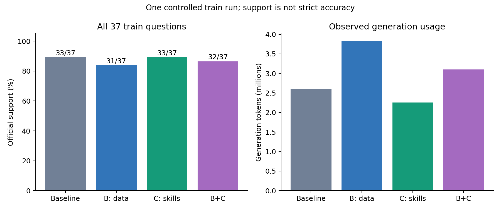

# A 集成与四配置完整 train 交接

2026 年 11 月 25 日，在 B、C 已合并的 `main` 基础上完成组合配置和四组完整 train 实验。生成方法固定为干净提交 `3f7e3ec965e8156d3bf126f2abf37f4555b90665`，每组使用全部 37 题、相同 `deepseek-flash`、温度 0、2500 输出 tokens、12 轮与16次工具调用上限。只切换数据工具与策略资源，不修改已有 baseline、B、C 方法。

## 完整结果

| 配置 | 支持 | 矛盾 | 信息不足 | 支持率 | 工具调用 | 生成总 tokens | 逐题作答耗时之和 |
| --- | ---: | ---: | ---: | ---: | ---: | ---: | ---: |
| 基础版 | 33 | 3 | 1 | 89.19% | 382 | 2,602,805 | 431.88秒 |
| 仅B数据优化 | 31 | 3 | 3 | 83.78% | 389 | 3,826,085 | 474.01秒 |
| 仅C策略优化 | 33 | 3 | 1 | 89.19% | 324 | 2,254,682 | 376.26秒 |
| B+C组合 | 32 | 4 | 1 | 86.49% | 327 | 3,099,085 | 410.79秒 |

四组各37条预测全部保存，缺失和空答案均为0；首次评分前已保存全部148条回答。每题重新初始化。各组使用同一源文件指纹，基础与优化索引的准备成本在 [design.json](design.json) 中单独记录。

四组并发度为4，题内请求顺序执行。API负载、缓存和固定配置均可能影响时间，耗时差只作描述；tokens是累计多轮上下文用量，不能直接当作人民币账单。一次开发实验不提供稳定泛化或显著性结论，train也不是独立测试集。



## 评分超时与恢复

首轮每组各有1个检查器读超时，原报告完整保留在 `evaluations/judge_v1/`。未根据失败重新作答；仅使用同一模型、端点、原问题、参考答案和已保存回答，调用老师原始 `call_judge`、`normalize_judgment` 与 `summarize` 函数重试4个失败请求。成功判定不重新请求，也不选取多个评分中的较高值。

恢复后的报告保存在 `evaluations/judge_recovered_v1/`，明确标记为基于原报告的恢复派生结果，并记录原报告指纹、预测指纹、老师脚本指纹和每次重试。最终每组 `evaluation_complete=true`、`api_failed=0`，分母仍为37。生成请求不变；检查器初始148次、恢复4次，共152次。原始评测文件未修改。

## 运行质量与错误

| 配置 | runner标记completed | 工具失败返回 | 成功计算调用 | 最终正文含已知工具标记 |
| --- | ---: | ---: | ---: | ---: |
| 基础版 | 37 | 26 | 96 | 1 |
| 仅B | 37 | 40 | 71 | 3 |
| 仅C | 37 | 11 | 104 | 1 |
| B+C | 37 | 3 | 83 | 3 |

工具失败包括参数、SQL、算术错误和预算拒绝；模型随后可能恢复。`completed` 仅表示当前 runner 接受了非空正文及已获取的来源，不是正确性或有效最终答案的证明。最终正文中的 DSML 伪工具标记是实际缺陷，尤其仅C与基础版的 `FQA-702165-07` 仍是计划/调用文本，不能算正常财务回答。没有手工修改这些预测，也未将它们从分母删除。

全部官方非支持判定及正文标记案例见 [error_cases.json](error_cases.json)，各组 `trace_audit.json` 只分析可观察调用，不提供完整正确率。

## 原始数据抽查

[manual_audit.json](manual_audit.json) 记录5个争议案例的原年报位置、文件指纹、片段和分析，并附4条ServiceNow来源事实：

- ServiceNow债务：年报明确记载旧2022可转债已转换或结清。参考答案强调可转债，涉及期间或债务类别差异。
- ServiceNow递延收入：FY2024/2023流动部分为6819/5785百万美元，非流动部分95/81百万美元。不能把参考答案侧重非流动的描述直接当作全部来源事实。
- Norfolk运量：原表2024/2023总量7056.8/6744.4千单位，披露变动5%；“稳定/增长”与选择的运量指标存在解释差异。
- Moderna分部：单一财务报告分部与四大业务franchises不是同一概念。模型收窄到财务分部后否认业务领域，仍可能没有完整回应问题。
- Moderna回购：Item5确有回购授权与剩余额度，但授权不等于当期实际回购或持续执行承诺。

这些是来源核对及可能的参考期间/覆盖差异，不是擅自改判参考答案。官方标签原样保留；也没有声称穷尽核查所有数字、引用与定性结论。

## 下一阶段候选与未完成项

本轮推荐 **仅C策略配置 `skill_optimized.json` 作为下一阶段候选**。它与基础版支持数相同、为本轮并列最高，生成tokens少13.37%、工具调用少15.18%；观察到的耗时少12.88%，不能当作可靠加速。B+C组合本轮没有优于仅C，因此不因“优化更多”自动选组合版。完整依据及边界见 [selection.json](selection.json)。

尚未冻结方法或运行正式test。正式test前应明确整改或拒绝伪工具正文，核查关键财务口径和来源，再验证候选方法、保存最终版本并冻结。整改后的实验必须另存，不能覆盖这次共同方法上的四配置原始比较。正式19题test必须在固定方案下整批自动作答、先保存再评分，不利用test反馈选择方法。

本文件是A的实验交接材料，不是C负责的正式课程报告。报告正文与PDF仍由C统一撰写。

## 文件与复现

- [comparison.json](comparison.json)、[metrics.csv](metrics.csv)：完整37题口径、逐公司与逐题配对、调用和用量。
- 每个配置目录：原预测、摘要、方法快照、完整公开模型/工具日志，以及运行后核查。
- `evaluations/`：首次原评分与失败请求恢复结果；评分材料不得接入作答Agent。
- [artifacts.json](artifacts.json)：完整本地原始输出ZIP的位置、大小和指纹。ZIP保留生成时原始字节；仓库文本按LF保存，区别仅为换行规范。
- [plot_comparison.py](plot_comparison.py)：重建本页PNG和PDF图。
- [verification.json](verification.json)、[checksums.json](checksums.json)：完整性检查与仓库LF口径校验值。评分恢复中的原始字节SHA对应ZIP内文件，`artifacts.json`另列仓库LF对应SHA，避免Windows换行转换被误当作内容修改。

```powershell
.\.venv\Scripts\python.exe -X utf8 -m extension2_finance_agent.experiments.full_train --output extension2_finance_agent/outputs/full_train_new --jobs 4
.\.venv\Scripts\python.exe -X utf8 -m extension2_finance_agent.experiments.recover_judge --output extension2_finance_agent/outputs/full_train_new --source-id judge_v1 --target-id judge_recovered_v1
.\.venv\Scripts\python.exe results/extension2/full_train_v1/plot_comparison.py
```

第二条仅在有API_FAILED时使用，同一输出目录和已有评分目标不会覆盖。完整实验说明见 [experiments/README.md](../../../extension2_finance_agent/experiments/README.md)。
