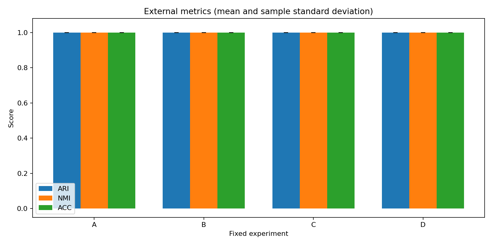
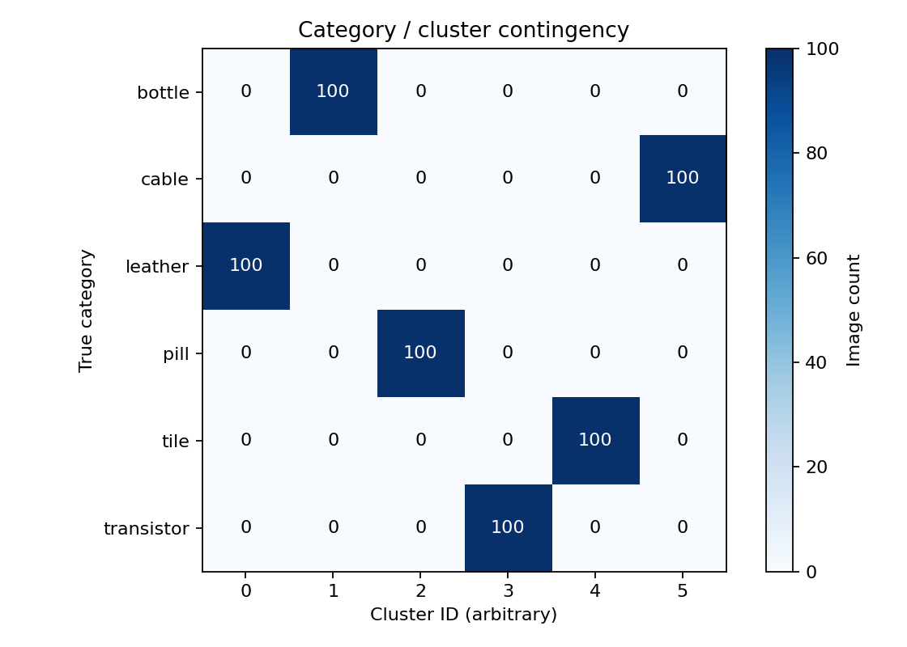
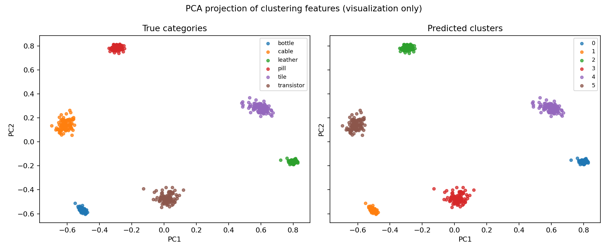
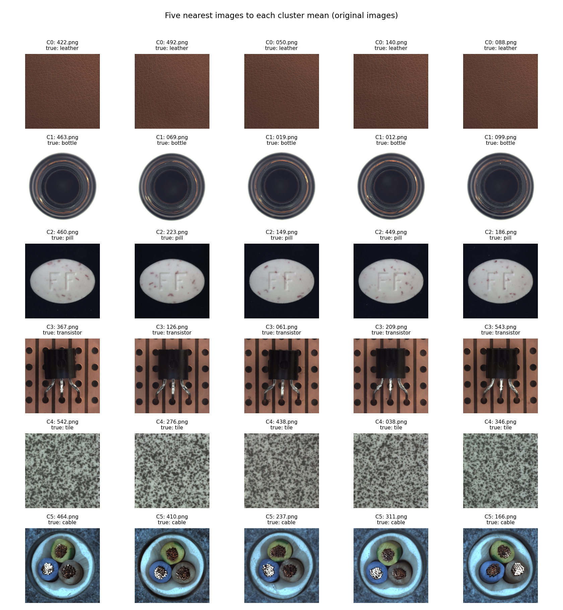

# 任务1：图像无监督聚类实验报告

## 1. 问题定义与数据

本任务对课程Cluster数据集进行无监督分组。数据包含600张RGB图像，分为bottle、cable、leather、pill、tile、transistor六类，每类100张。
原图尺寸为1024×1024共300张，800×800、840×840、900×900各100张，图片全部可解码，内容摘要核验无重复文件。

给定图像集合 $X=\{x_i\}_{i=1}^{600}$，通过特征函数 $z_i=f(x_i)$ 获得数值向量，输出簇编号 $c_i\in\{0,\ldots,5\}$。全部图像参与聚类，类别标签用于数据核验和最终评估。

## 2. 图像特征处理

### 2.1 预处理

图像统一转换为RGB，使用双线性插值将短边缩放至256，再中心裁剪为224×224。深度特征输入按ImageNet均值[0.485, 0.456, 0.406]与标准差[0.229, 0.224, 0.225]进行归一化。

### 2.2 传统颜色与纹理特征

HSV三个通道各计算16个区间的颜色直方图；灰度图计算uniform LBP，参数P=8、R=1，获得10维纹理直方图。各直方图L1归一化后拼接为58维向量，再进行StandardScaler标准化和L2归一化。

### 2.3 深度特征与PCA

使用ImageNet有监督预训练的ResNet-18（IMAGENET1K_V1），冻结编码器参数，将分类层替换为恒等映射，提取512维全局平均池化特征。
主方案对特征进行L2归一化，使用完整SVD计算PCA、保留95%累计解释方差，随后再次L2归一化。本次得到29维向量，累计解释方差为95.0285%，特征维度减少94.34%。

## 3. 聚类算法与实验设置

K-Means以簇均值作为中心，交替更新样本分配与簇中心，最小化簇内平方距离：

$$\min_{c,\mu}\sum_{i=1}^{600}\left\|z_i-\mu_{c_i}\right\|_2^2.$$

簇数设为6。采用k-means++初始化，20次重启，最多300轮Lloyd迭代，收敛阈值为1e-4。该方法能够直接利用图像特征的距离结构，适合本任务的样本规模和已知类别数。
算法对照采用Ward凝聚层次聚类，每轮合并使簇内方差增量最小的两个簇，使用欧氏距离，最终得到6簇。

| 方案 | 特征处理 | 聚类算法 |
| --- | --- | --- |
| A | HSV＋LBP，58维，标准化后L2归一化 | K-Means |
| B | ResNet-18，512维，L2归一化 | K-Means |
| C：主方案 | ResNet-18，L2＋PCA95%＋L2 | K-Means |
| D | 与C相同 | Ward层次聚类 |

A、B、C分别使用随机种子42、43、44、45、46运行五次，D运行一次，共16次实验。运行环境为Windows、Python 3.11.15、PyTorch 2.7.1+cpu、scikit-learn 1.7.2，使用CPU计算。

## 4. 评价指标与结果

外部指标为ARI、NMI和ACC。ARI评价样本对的分组一致性，NMI评价类别划分与聚类划分的共享信息；ACC先通过最优一对一匹配对齐簇编号和类别，再统计正确分组比例。
内部指标为欧氏轮廓系数和Davies–Bouldin指数（DB）。前者越大表示当前特征空间中的分组越清晰，后者越小表示簇内与簇间距离的比例更理想。

| 方案 | 次数 | 维度 | ARI | NMI | ACC | 轮廓系数 | DB指数 |
| --- | ---: | ---: | ---: | ---: | ---: | ---: | ---: |
| A：HSV＋LBP＋K-Means | 5 | 58 | 1.0000 | 1.0000 | 1.0000 | 0.7114 | 0.5094 |
| B：ResNet-18＋K-Means | 5 | 512 | 1.0000 | 1.0000 | 1.0000 | 0.6783 | 0.5398 |
| C：ResNet-18＋PCA＋K-Means | 5 | 29 | 1.0000 | 1.0000 | 1.0000 | 0.7654 | 0.3939 |
| D：ResNet-18＋PCA＋Ward | 1 | 29 | 1.0000 | 1.0000 | 1.0000 | 0.7654 | 0.3939 |

表中为均值；A、B、C三个方案的ARI、NMI、ACC在五个种子下的样本标准差均为0。每次实验的600张图像均形成6个非空簇，每簇100张。

主方案中，各簇与六个真实类别一一对应。列联热力图的每一行、每一列均只有一个非零值100，ACC为100%。

二维PCA投影展示主方案29维聚类特征的主要变化方向。左右两图使用相同坐标，分别按真实类别和簇编号着色，六组样本具有清晰的分离结构。

## 5. 对照实验与图像分析

### 5.1 特征与算法对照

传统颜色与纹理特征已能完整区分六类图像；深度特征方案、PCA方案和Ward方案也得到相同的类别划分。外部评价指标均达到1.0，本数据集上各方案的差别主要体现在特征维度与计算开销。
PCA将深度特征从512维压缩到29维。K-Means平均拟合时间由原始深度特征方案的0.2362秒下降到主方案的0.0745秒；PCA变换耗时约0.1079秒。内部指标分别反映各方案特征空间中的几何结构。

### 5.2 图像观察与分组结果

下图展示各簇距离均值最近的五张原图。leather呈棕色皮革纹理，tile呈灰色颗粒纹理；pill为深色背景上的白色药片，bottle主要为白色背景上的圆形瓶口；cable具有蓝色外缘与彩色线芯，transistor具有铜色载板背景。类别之间的颜色、纹理、物体形状与背景差异，为传统描述子和深度特征提供了清晰的分组依据。

主方案600张图像的匹配类别全部正确，误分样本数为0；五个指定种子得到一致的分组。该结果对应给定600张图像的全量聚类实验。

## 6. 运行与复现

完整16次实验和图表生成耗时141.61秒，其中传统特征提取40.28秒，深度特征提取48.50秒。主方案命中特征缓存后约14.81秒；独立新环境重提取特征并运行主方案约47.96秒。
自动化测试覆盖数据读取、缓存校验、标签使用边界、簇编号匹配及固定种子复现，共21项测试通过。提交前从干净克隆中新建Python 3.11虚拟环境，核对37项锁定依赖，重新运行全部16次实验；逐次指标、汇总指标和四个代表运行的逐图像分组均与本报告结果一致。

复现命令与数据放置方式见[任务1 README](../../task1_clustering/README.md)。本目录的[summary.csv](summary.csv)、[metrics.csv](metrics.csv)提供精确指标；[run.json](run.json)记录环境与源码摘要，[verification.json](verification.json)记录验证结果。各方案的配置和逐图像分组位于[experiments](experiments/)。

## 7. 结论

本实验完成了600张图像的六类无监督聚类。四个方案的ARI、NMI、ACC均为1.0，传统颜色与纹理描述已经能够完成本数据集的分组。主方案通过冻结的ResNet-18获得图像表征，并以PCA压缩特征，得到准确且可复现的聚类结果。
