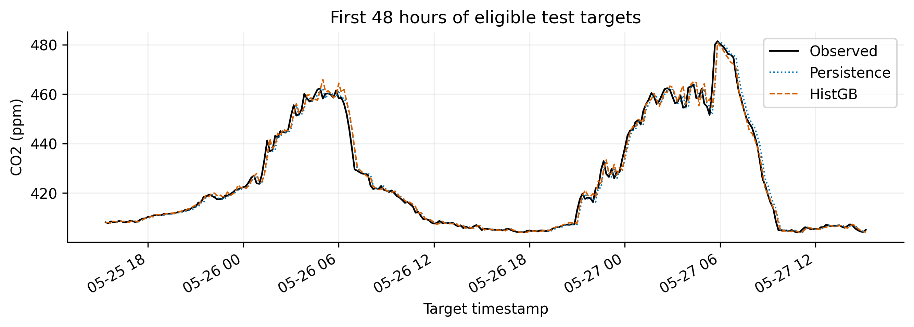
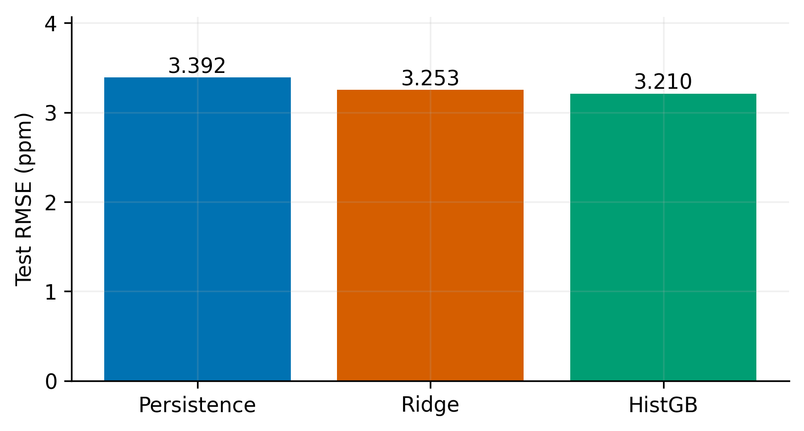

# 任务三：时间序列预测实验记录

目标：过去 12 个时间点的全部 21 个指标组成 252 维输入，预测下一时刻 CO₂ 浓度，单位 ppm。这里预测浓度值，而非浓度差值；模型内部以变化量学习，输出时加回上一时刻浓度。

## 数据与处理

原始 26200 行，删除 1 个重复时间戳后 26199 行；时间跨度 2020-01-01 00:10:00 至 2020-07-01 00:00:00。-9999 是缺失标记，各列数量见 data_quality.json。仅对输入前向填补，首部缺失回退训练中位数；目标缺失不填补。只保留输入至目标均连续、相隔 10 分钟的窗口，跨越采样间断的窗口丢弃。

按原始行时间顺序 60%/20%/20% 划分训练、验证、测试。各分区独立构造窗口，第一批 12 行只作输入，避免窗口重叠到其他分区。标准化统计量只从当前拟合分区学习。测试采用滚动单步预测：预测下一时刻时，前面已观测的测试期指标可作为历史输入，不是一次性预测整段未来。

| split | samples | first_target | last_target |
| --- | --- | --- | --- |
| train | 15673 | 2020-01-01 02:10:00 | 2020-04-19 03:50:00 |
| validation | 5228 | 2020-04-19 06:00:00 | 2020-05-25 13:10:00 |
| test | 5216 | 2020-05-25 15:20:00 | 2020-07-01 00:00:00 |

## 方法与模型选择

Persistence：下一时刻预测为最近一次 CO₂ 浓度。Ridge：标准化全部滞后特征后做 L2 正则线性回归。HistGB：直方图梯度提升树拟合非线性关系。后两者学习 y(t)-y(t-1)，预测时加回 y(t-1)，仍然使用全部 252 维历史指标。候选网格、验证误差与耗时完整保存于 validation_search.csv。

仅按验证 RMSE 选定 **HistGB**，然后各模型分别使用训练与验证的合格窗口重新拟合，在同一测试集做最终评价。所有模型的标准化器随拟合重新学习；测试数据不参与选择、拟合或早停。

## 测试结果

| model | selected_on_validation | MAE_ppm | RMSE_ppm | R2 | fit_predict_seconds |
| --- | --- | --- | --- | --- | --- |
| Persistence | False | 1.8723 | 3.3916 | 0.9775 | 0.0030 |
| Ridge | False | 1.8189 | 3.2535 | 0.9793 | 0.2773 |
| HistGB | True | 1.7590 | 3.2104 | 0.9799 | 7.1960 |

MAE=mean(|y-ŷ|)，RMSE=sqrt(mean((y-ŷ)²))；R² 相对测试集均值计算。误差越小越好，R² 越大越好。最终采用验证集选定的模型，而不是事后选择测试分数最好的模型。

## 分析与限制

HistGB 的测试 MAE 为 1.759 ppm、RMSE 为 3.210 ppm，较持续值基线的 3.392 ppm 低 5.34%。相同测试窗口上的岭回归 RMSE 为 3.253 ppm。验证 RMSE 为 2.208 ppm，低于测试 RMSE，单次切分不足以区分季节变化与其他影响。

短期 CO₂ 具有连续性，Persistence 是必要基线；复杂模型是否有效必须依据与该基线的同口径对比。前 48 小时曲线只作可视化，指标使用全部合格测试窗口。半年时间序列后段分布可能不同于训练期；单次时间划分不足以证明跨年份泛化。正常的真实极端值不作主观删除。逐点预测可用于复核，模型文件仅加载可信来源。
