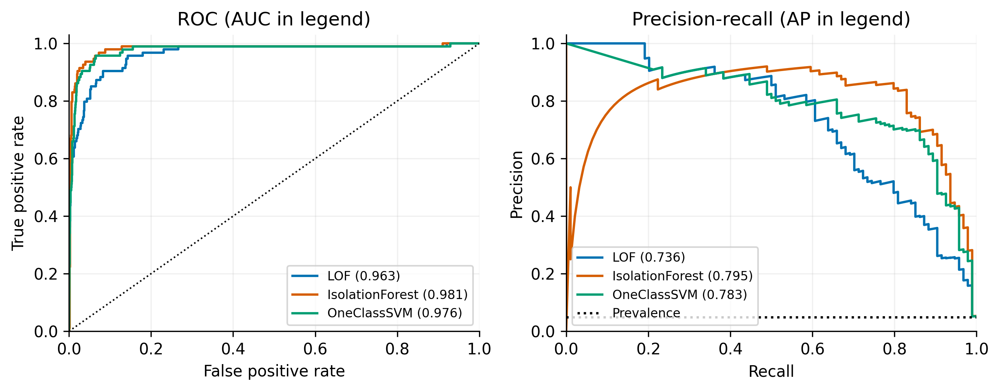
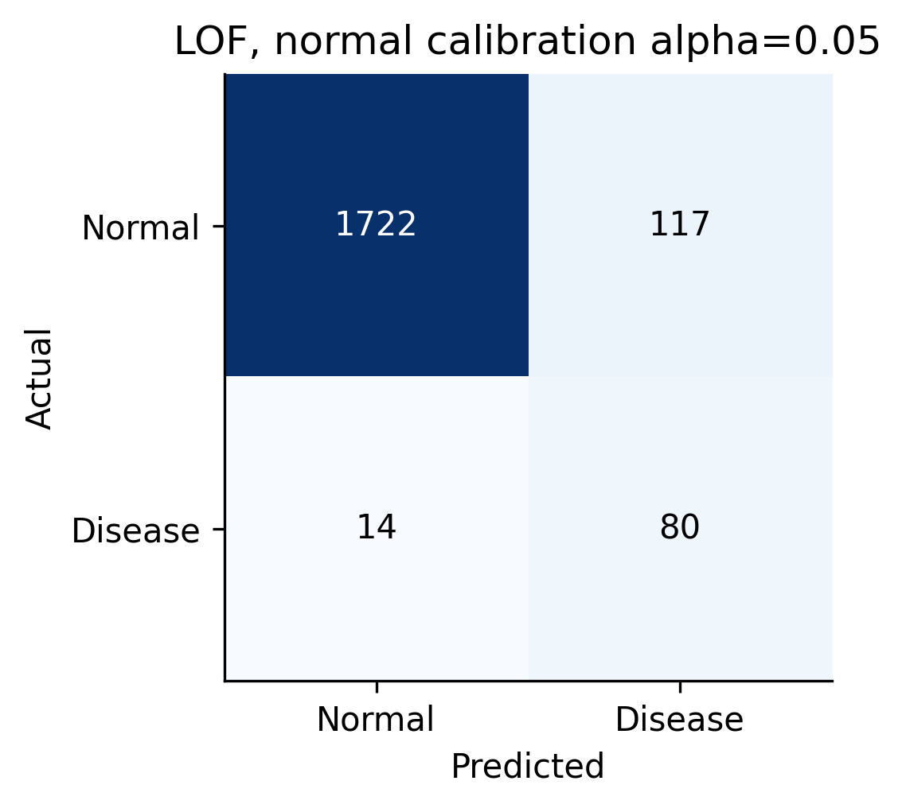

# 任务四：无监督疾病判断实验记录

## 问题与数据

给定仅包含正常样本的训练集，用正常分布学习新颖性检测器，将偏离正常模式的测试样本判为患病（1），否则判为正常（0）。原文件没有真实医学特征含义，因此只使用 feature_1 至 feature_6，不推断指标名称。

训练 1839 行，测试 1933 行，测试正常 1839 行、患病 94 行（患病率 4.86%）。两文件合计 3772 行，与说明的 3772 一致。无缺失值。训练重复 57 行，测试重复 23 行；测试中 56 行特征向量也出现在训练中。官方测试集保持原样，重复不等同于可确认的数据错误，也不能据此判断患者身份。

## 无监督方法与阈值

预先指定 LOF 为主方法（novelty=True，35 邻居），以局部正常密度变化识别异常；固定比较 Isolation Forest（300 棵树）与 RBF One-Class SVM（nu=0.05、gamma=scale）。未使用测试标签选择模型或超参数。

仅将正常训练样本按相同特征向量分组，以随机种子 2026 划分拟合 1476 行和校准 363 行，相同特征不跨分区。StandardScaler 仅在拟合子集上训练，所有检测器仅在该子集拟合；保留校准子集，不在阈值确定后重训。LOF 的新颖性打分仅用于未参与拟合的校准和测试数据。

所有分数取负 score_samples，越大越异常。设正常校准分数 s₁,…,sₘ，固定 alpha=0.05，采用第 ceil((m+1)(1-alpha)) 个顺序统计量作阈值，新样本分数严格大于阈值则判异常。这是正常样本分布下的误报控制设计，不是从测试患病比例反推阈值。训练/测试分布偏移或重复依赖使独立同分布假设不完全成立，不能保证实际测试误报率恰为 alpha。

## 测试结果

| model | primary | alpha | threshold | ROC_AUC | PR_AP | precision | recall | F1 | accuracy | balanced_accuracy | TN | FP | FN | TP | test_FPR |
| --- | --- | --- | --- | --- | --- | --- | --- | --- | --- | --- | --- | --- | --- | --- | --- |
| LOF | True | 0.0500 | 1.5903 | 0.9628 | 0.7361 | 0.4061 | 0.8511 | 0.5498 | 0.9322 | 0.8937 | 1722 | 117 | 14 | 80 | 0.0636 |
| IsolationForest | False | 0.0500 | 0.5638 | 0.9810 | 0.7950 | 0.5087 | 0.9362 | 0.6592 | 0.9529 | 0.9450 | 1754 | 85 | 6 | 88 | 0.0462 |
| OneClassSVM | False | 0.0500 | -2.9310 | 0.9765 | 0.7830 | 0.4830 | 0.9043 | 0.6296 | 0.9483 | 0.9274 | 1748 | 91 | 9 | 85 | 0.0495 |

ROC-AUC 评价异常排序，PR_AP 是 average precision，并非梯形积分 PR-AUC。患病率低，因此不能仅看 accuracy；同时报告 precision、recall、F1、balanced accuracy 和混淆矩阵。预先指定的主方法始终是 LOF，即使其他方法测试分数更高也不更改主方法。

## 阈值敏感性

以下 alpha=1%、5%、10% 均为预设，仅作评价，不用于根据测试标签调整正式阈值。

| alpha | precision | recall | F1 | test_FPR |
| --- | --- | --- | --- | --- |
| 0.0100 | 0.7229 | 0.6383 | 0.6780 | 0.0125 |
| 0.0500 | 0.4061 | 0.8511 | 0.5498 | 0.0636 |
| 0.1000 | 0.2622 | 0.9149 | 0.4076 | 0.1316 |

## 分析与限制

LOF 检出 94 个患病样本中的 80 个，漏报 14 个，在 1839 个正常样本中误报 117 个。孤立森林在固定比较中检出 88 个，误报 85 个，F1 为 0.6592，高于 LOF 的 0.5498。主方法仍按预先设定的 LOF 报告。

LOF 使用局部密度，孤立森林使用随机隔离，One-Class SVM 使用正常样本边界，不同假设可能产生不同的漏报与误报。较宽松阈值通常提升召回并增加误报，需结合上表实际结果判断。只有正常训练样本无法针对患病 F1 做有监督调参。本实验只是课程数据上的异常检测评价；给定数据已经经过脱敏变换，无法确认上游标准化是否使用全量数据，当前流程另行保证新增预处理只用训练子集。没有患者标识，无法证明患者级独立性。
